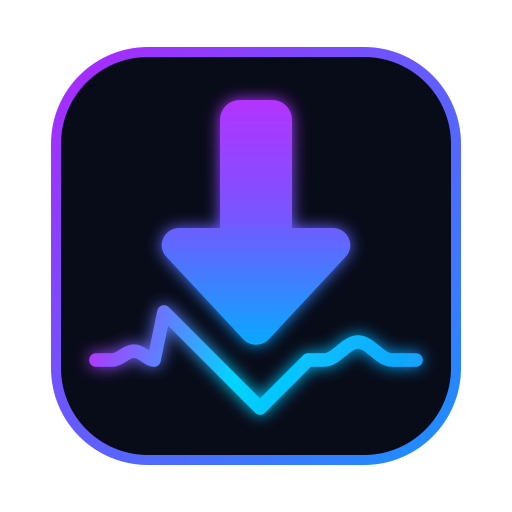

<div align="center">
  
  <h1>DownloadPulse</h1>
  <p><strong>All your downloads. One queue.</strong><br/>A free, open-source download manager for your desktop or server.</p>
  <p><a href="https://downloadpulse.net"><strong>downloadpulse.net</strong></a></p>

  [](LICENSE)
  [](https://github.com/Xipher-Zero/downloadpulse/actions/workflows/tests.yml)
  [](https://github.com/Xipher-Zero/downloadpulse/actions/workflows/image.yml)
</div>

---

## What is DownloadPulse?

**DownloadPulse** is a free, open-source download manager for your desktop or server. Links, files and videos from your browser, your scripts and your other apps go into one queue that recovers from failures by itself.

Downloads come from everywhere: a link in your browser, a file on another server, a video page, a job from a script. DownloadPulse turns each one into a single download that keeps its place and its history until it is done, whatever it takes to finish it. Run it on the computer you use every day with the [desktop app](#desktop-app), or keep your queue on your own server or NAS and manage it from any of your devices.

What you get:

- **One queue for every way in.** Paste links into Quick Add, send them from your browser with the [browser extension](https://downloadpulse.net/extension), or submit them from your own scripts and apps through the [REST API](#rest-api). Every download lands in the same queue, with its progress and history in one place.
- **Direct links, files and videos, straight away.** Web links (HTTP and HTTPS), FTP and SFTP, SCP, rsync, WebDAV, Metalink files and supported video pages work without any account or extra software to install.
- **Faster direct downloads.** DownloadPulse can fetch different parts of a file in parallel when the host supports it.
- **Recovery without babysitting.** Temporary failures are retried. When another source or service can deliver the same file, DownloadPulse can switch to it, and it stays the same download, with its history intact. Its details show what was done along the way.
- **Your files, your choice.** Pick where finished downloads go; archives can be extracted for you.
- **For one person or many.** The desktop app is yours alone. A server gives each person their own sign-in and role, with a password or through your own OpenID Connect provider.

Optional, when you want them (each is off until you turn it on, and none is required):

- premium debrid services (AllDebrid, Debrid-Link, Premiumize, Real-Debrid, TorBox) for file-hoster links, magnets and `.torrent` files;
- Usenet with your own news servers, for NZBs;
- Sonarr and Radarr, which can use DownloadPulse as their download client;
- Discord notifications and Prometheus metrics.

This README describes `v1.0.4`. Check [GHCR](https://github.com/Xipher-Zero/downloadpulse/pkgs/container/downloadpulse) for the published image tags, and [`CHANGELOG.md`](CHANGELOG.md) for what is included and the **known limitations** of each release. The website, with guides for the desktop app, the server and the browser extension, is [downloadpulse.net](https://downloadpulse.net).

---

## Desktop app

DownloadPulse Desktop is one person's DownloadPulse on their own computer: no server needed. It has the same queue as the server, and the browser extension finds it on the same computer by itself. Close the window and your downloads keep going from the tray.

| System | Download |
|---|---|
| **Windows** 10 and 11, 64-bit | An installer that installs for you alone, without administrator rights |
| **macOS** 13 or later, on Apple silicon | A disk image: open it and drag DownloadPulse to Applications |
| **Linux**, 64-bit | A Flatpak bundle, installed for your user alone |

Download the current release from [downloadpulse.net/desktop](https://downloadpulse.net/desktop) or from the [GitHub Releases page](https://github.com/Xipher-Zero/downloadpulse/releases). The installers are not signed yet: the desktop page explains what to do when Windows or macOS warns you.

The desktop app is built for one person. For a household or a team, run the [server](#installation): everyone gets their own sign-in.

---

## Core features

| Feature | Description |
|---|---|
| **Unified Dashboard submission** | Paste links (HTTP(S), FTP, SFTP, SCP, rsync, WebDAV, media pages) and magnet URIs into one mixed-input control, or use the same Add action with an empty field to choose a `.torrent`, NZB, Metalink or link file |
| **Batch link submission** | Submit up to 100 unique direct links in one tracked transaction |
| **Provider routing** | Premium debrid services and Media Downloads claim what they support as `SPECIALIZED`; General HTTP(S) supplies the `GENERIC` direct-download path when no specialized claim wins; a provider that gives up hands over to another that can take the request |
| **Premium services** | AllDebrid, Debrid-Link, Premiumize, Real-Debrid and TorBox for hoster links, magnets and `.torrent` files (and NZBs where the service offers them), with backup torrents prepared on a second provider |
| **Usenet** | A bundled, private SABnzbd downloads NZBs from your own news servers |
| **Network sources** | FTP & SFTP, SCP, rsync, WebDAV and Metalink sources, with sign-in prompts when a server asks |
| **Media Downloads** | yt-dlp downloads from media pages it explicitly recognizes, without re-encoding |
| **Service and source switching** | Choose another service for a download (best effort, link by link), or another confirmed-equivalent source for its files; a source chosen for a paused file that had already started is recorded, shown beside the controls and applied on Resume. The row shows the committed service and source, with a pending switch beside it, never as it (see [Switching and recovery](#switching-and-recovery)) |
| **Sonarr and Radarr** | DownloadPulse acts as a qBittorrent or SABnzbd download client through Integration Delivery Profiles |
| **User accounts and roles** | Admin, User, ReadOnly User and Integration accounts enforced by the server |
| **Backups and restore** | Scheduled backups and in-application restore |
| **Durable provider provenance** | Recent Activity, Downloads, and Details show current/final provider and ordered route history from persisted facts rather than URL inference |
| **Magnet links** | Submit one or more magnets to the premium services that accept them |
| **Torrent files** | Upload `.torrent` files to the premium services that accept them |
| **Pause-safe intake** | Pause All stops processing, not intake: new links, magnets, and `.torrent` files are recorded locally and begin provider work after Resume All |
| **Provider-side preparation** | Waits for a premium service to prepare its copy or to generate a delayed link, without losing the transfer's place |
| **Managed aria2** | DownloadPulse starts, configures, and supervises its bundled aria2 daemon for a self-contained deployment |
| **Unified Downloads view** | Direct links, magnets, torrent files, and imported transfers share one lifecycle and history |
| **Recent Activity** | Dashboard view of active and recently processed downloads |
| **Retry and recovery** | Retry failed transfers and regenerate expired provider download links from the original source |
| **Import from premium accounts** | Bring in transfers already present on an enabled premium service's account that DownloadPulse does not track yet |
| **Live status updates** | Server-Sent Events carry the application's pulse without requiring full-page polling |
| **Event log** | Searchable transfer and application event history |
| **Statistics** | Built-in operational and download statistics |
| **Auto-extraction** | Optional post-download extraction of common archive formats |
| **Notifications** | Optional Discord notifications for download lifecycle events |
| **Prometheus metrics** | Application and transfer metrics through `/api/metrics` |
| **SQLite persistence** | SQLite/WAL is the authoritative application datastore |
| **Native authentication** | Intentional no-auth mode, Username & Password browser sessions + HTTP Basic API access, provider-neutral OIDC, and optional bearer tokens for machine clients |

---

## Direct-link downloads

Direct HTTP(S) resources are first-class DownloadPulse transfers rather than untracked aria2 jobs.

Paste one or more HTTP/HTTPS links into the unified Dashboard submission field (direct links and magnets may be mixed, one item per line). DownloadPulse then:

1. validates and durably records the original resource;
2. evaluates enabled provider applicability without contacting a provider;
3. routes a host a premium service supports to that service as `SPECIALIZED`, otherwise routes an eligible ordinary HTTP(S) resource to the `GENERIC` **HTTP & HTTPS** provider;
4. records the selected provider route and canonical candidate;
5. dispatches the candidate to a download engine (aria2 for HTTP(S));
6. tracks progress and durable provider/executor provenance with the rest of the download queue.

When a premium service is the selected provider, delayed generation and later candidate refresh remain provider-owned behavior. When General HTTP(S) is selected, aria2 receives the validated direct resource; conventional HTTP authentication is requested only after a genuine supported authentication challenge. The same logical transfer continues after corrected credentials.

A single submission can contain up to **100 unique links**.

---

## Torrent downloads

DownloadPulse supports both magnet links and `.torrent` files.

For a torrent submission:

1. the magnet or torrent metadata is sent to a premium service that accepts it (AllDebrid, Debrid-Link, Premiumize, Real-Debrid or TorBox);
2. DownloadPulse monitors that service's torrent state, and may prepare a backup on a second service;
3. once files are available, their unlocked HTTP(S) links are retrieved;
4. those files are dispatched to aria2;
5. DownloadPulse tracks the complete transfer lifecycle locally.

DownloadPulse's aria2 is built without BitTorrent and never joins a swarm. The premium service performs the torrent-side work and aria2 downloads the resulting files.

---

## v1.0.4 provider and executor support matrix

This matrix is the **implemented and qualified v1.0.4 provider/executor set**. Anything not listed here is not supported.

| Integration | Kind | Enabled on a new installation |
|---|---|---|
| AllDebrid, Debrid-Link, Premiumize, Real-Debrid, TorBox | Premium providers | No — enable under **Settings → Services** and connect your account (none is required) |
| Usenet (bundled SABnzbd) | Provider with its own download engine | No — enable under **Settings → Services** |
| HTTP & HTTPS, FTP & SFTP, SCP, rsync, WebDAV | Network-source providers | Yes |
| Multimeta (Metalink) | Provider | Yes |
| Media Downloads (yt-dlp) | Provider with its own download engine | Yes |
| aria2, rsync | Download engines | Yes |

[`CHANGELOG.md`](CHANGELOG.md) lists the **known limitations** of each release under that release's entry (for example what cannot be switched, when a backup is promoted automatically, how a question waiting for input holds up the rest of a download, what cancelling one volume of a split archive does to extraction, what Sonarr and Radarr see, and how large sources are bounded).

---

## aria2

DownloadPulse starts its bundled aria2 daemon with the application and stops it on shutdown. The daemon
listens on loopback only; DownloadPulse constructs its RPC endpoint and credentials itself, applies the
native engine settings, and writes every download into the Download Folder. On restart DownloadPulse
reconciles its tracked downloads against the daemon.

Every aria2 job is still routed through the DownloadPulse egress guard with per-job proxy, credential,
and host-key settings, so a job never inherits daemon-wide network configuration.

---

## Switching and recovery

A transfer is not tied to the service, source or engine it started with. Where you are allowed to change a transfer:

- **Service:** the service name on a Dashboard or Downloads row opens the service picker. It lists the services that claim at least one of the transfer's confirmed-equivalent sources and switches only to those that can take one now. A service that can take the link in use takes over straight away; one that can reach a file only through another equivalent source prepares its copy first (**Preparing …**) while the file keeps downloading where it is.
- **Source:** the network button with a number opens the source chooser for a file's other confirmed-equivalent sources, or for sources common to every remaining file.
- **Paused transfers:** a source chosen for a paused file that had already started is recorded and shown beside the controls (for example *Switch to Real-Debrid (rapidgator.net) on resume*), and is applied when the transfer resumes. A service chosen while paused takes over at once, or after resume if it must prepare a copy; the transfer stays paused either way.
- **Recovery:** temporary failures are retried; a service that keeps failing is replaced by another that can take the transfer; a refused or failed switch leaves the transfer where it was and normal recovery continues.

Switches are best effort and checked again when made. The row shows the committed service and source; a switch that has not taken effect is shown beside it, never as it. The in-application **Help → How It Works** explains every message and state in detail.

---

## Installation

### Docker Compose

Clone the repository:

```bash
git clone https://github.com/Xipher-Zero/downloadpulse.git
cd downloadpulse
```

Review `docker-compose.yml` before starting it. It keeps DownloadPulse's files and your downloads in folders beside it (`./downloadpulse/` and `./downloads/`); change those paths to put them elsewhere. Your timezone, user and group (`PUID`/`PGID`, default 1000:1000) and public address go in `.env`, copied from `.env.example`; without one, the defaults apply. The generic example uses bridge networking and an explicit `8095:8095` port mapping; use host networking only when your platform specifically requires it.

**Set it up from your own network first.** Until its Setup Wizard is finished, a new installation has no sign-in, and whoever opens it first sets it up. So setup is refused to anyone reaching it from the internet; your home network, a VPN and the server itself work as usual. Finish setup before forwarding the port or putting it behind a public address. A Standalone server asks for a password during setup; afterwards you may clear it in **My Account** if you want DownloadPulse open on a network you trust. A reverse proxy must pass on where each request came from (`X-Forwarded-For`, as Caddy, Traefik, Nginx Proxy Manager and cloudflared do by default), or the check cannot see it: details in [docs/authentication.md](docs/authentication.md#first-run-setup).

Then start DownloadPulse:

```bash
cp .env.example .env   # optional: then edit it
docker compose up -d
```

Open:

```text
http://your-server:8095
```

The first time it opens, the **Setup Wizard** walks through a new installation: the interface language, the **Deployment Type** (**Standalone**, one person as the built-in Administrator, or **Server**, several people with their own accounts), the **Download Directory**, the sign-in (on a Standalone server, the password you will sign in with; on a Server, the username and password of your own **Administrator** account; either turns on password sign-in), optional **Premium Services**, and **Getting Started**. Each step is saved when you select **Next**. On a Server, sign in with the new Administrator account after **Finish & Open Dashboard**. An Admin can run it again from **My Account → Rerun Setup Wizard**; a rerun changes no account.

Everything the wizard sets can be changed later in **Settings**. Go to **Settings → Services**. Network sources are switched on in a new installation; every premium service is off until you turn it on (connecting a Real-Debrid or TorBox account turns that service on once the connection is proven). Enable the premium services you intend to use and connect each premium service's account (an API key, or the service's own device sign-in). **HTTP & HTTPS** intentionally has only its canonical enable control. If the installation is reachable by users or networks you do not fully trust, configure native access control under **Settings → Authentication** before exposing it beyond that trusted boundary.

### Docker image

DownloadPulse runs as a server application with a browser interface; images are published for `linux/amd64` and `linux/arm64`. Every image is built once immutably and tagged by its full source SHA (`sha-<commit>`), then scanned and runtime-qualified on `linux/amd64` and `linux/arm64` with signed in-registry attestations; a versioned tag is only ever re-pointed at a digest that already passed every required gate.

Versioned images use the release tag:

```text
ghcr.io/xipher-zero/downloadpulse:v1.0.4
```

Example:

```bash
docker run -d \
  --name downloadpulse \
  --restart unless-stopped \
  -p 8095:8095 \
  -e PUID=1000 \
  -e PGID=1000 \
  -e TZ=Etc/UTC \
  -e CONFIG_PATH=/app/config/config.json \
  -e DB_PATH=/app/data/downloadpulse.db \
  -v /path/to/downloadpulse/config:/app/config \
  -v /path/to/downloadpulse/data:/app/data \
  -v /path/to/downloads:/download \
  ghcr.io/xipher-zero/downloadpulse:v1.0.4
```

Adjust the paths and UID/GID for your system. `CORS_ORIGINS=*` prevents startup: list explicit origins, or leave it unset.

**Rootless Podman.** The container starts as root, sets the ownership of `/app/config`, `/app/data` and `/download` to `PUID:PGID`, then runs DownloadPulse as that user. Under rootless Podman's default user namespace, a container UID such as 1000 is a sub-UID on the host, so those folders end up owned by an ID your host user cannot read. Run it with `--userns=keep-id --user 0:0` and set `PUID`/`PGID` to your host user's `id -u`/`id -g`: the container UID then is your own, and the files are yours. `--userns=keep-id` alone is not enough, because the container would then start as your user rather than root and could not switch users.

**Private data.** `/app/config` and `/app/data` are mode 0700, and the database and its journal files (`-wal`, `-shm`) 0600, all owned by `PUID:PGID` and set again at every start. A backup tool that copies them must run as `PUID:PGID` (on Unraid the image's default, 99:100, unless you set `PUID`/`PGID`) or as root.

---

## Configuration

The primary supported configuration is available through **Settings**.

### Services

**Settings → Services** lists the Premium Services (AllDebrid, Debrid-Link, Premiumize, Real-Debrid, TorBox and Usenet), each with its own enable control, account connection (news servers for Usenet) and Additional Settings for that service alone, and the Network Sources (HTTP & HTTPS, FTP & SFTP, SCP, rsync, WebDAV, Multimeta and Media Downloads), each with its own enable control.

Provider enablement is backend-owned configuration. `enabled`, `configured`, provider health, and current host availability are distinct facts.

### Authentication

Authentication has its own Settings tab.

DownloadPulse supports four effective interactive states:

- **No authentication** — supported for trusted standalone/LAN deployments;
- **Username & Password** — browser sign-in through the DownloadPulse login page, with HTTP Basic available to REST clients using the same credentials;
- **OIDC** — provider-neutral OpenID Connect Authorization Code + PKCE browser sign-in;
- **Username & Password + OIDC** — OIDC-preferred browser UX with the known-working local password path retained.

Accounts and roles (Admin, User, ReadOnly User and Integration) are managed under **Settings → Users & Access**. Integration accounts carry the `dp_...` bearer tokens used by automation, Prometheus, Sonarr and Radarr; a token is shown only once and only its verifier is stored.

DownloadPulse includes lockout protections: Password cannot be disabled in favor of OIDC until a real OIDC login succeeds, and critical OIDC changes in OIDC-only mode stay pending until the proposed configuration itself completes a successful sign-in. Deliberately disabling all interactive authentication requires explicit confirmation.

See **[docs/authentication.md](docs/authentication.md)** for configuration examples, reverse-proxy/OIDC callback guidance, API authentication, credential lifecycle, and recovery behavior.

### Downloads

Configure:

- the download folder and the number of downloads running at once;
- under **Download Behavior & Limits → Advanced Settings**: continuation timing, local-network access, and shared polling, premium-service inventory synchronization, and global resolution-retry settings -- **Provider Poll Interval** (how often work a service is still preparing is rechecked), **Full Sync Interval** (how often downloads are reconciled with enabled premium accounts that can list their transfers) and **Resolution Failure Retries** with **Retry Delay** (for any service, Network Sources included);
- per-engine tuning for network sources, rsync, WebDAV, Usenet and Media Downloads;
- disk-space limits and download recovery.

### Extraction

Configure optional archive extraction. DownloadPulse enforces per-archive file-count, expanded-size, and compression-ratio limits. Every supported archive format is extracted into an isolated staging directory, validated, and committed to the download tree with no-clobber semantics.

### Notifications

Configure optional Discord lifecycle notifications.

### Data & Maintenance

DownloadPulse uses a single authoritative SQLite/WAL database. Configure its persistent path through `DB_PATH` or the container data mount.

The **Data & Maintenance** tab configures scheduled backups (backup folder, interval, retention and the number kept), lists and restores backups in the application, holds the statistics snapshot settings and Event Logging, and the guarded **Reset Database** action. Reset stays locked until **Allow Database Reset** is enabled; it always creates a safety backup first and is aborted if that backup fails.

---

## Dashboard

The Dashboard is intended for current activity and common download submission.

It provides:

- one unified submission field for links (HTTP(S), FTP/SFTP, SCP, rsync, WebDAV, media pages, NZB links) and magnets;
- `.torrent`, NZB, Metalink and link-file selection from the same Add control when the field is empty;
- import and recovery controls;
- current queue state;
- completion and error counts;
- recent download activity.

The Dashboard intentionally shows only a small Recent Activity window. Use **Downloads** for full transfer history and management.

**Pause All stops processing, not intake.** Submissions made while globally paused are durably recorded with a paused state; no new provider or download-engine work is started until Resume All (or an explicit per-transfer resume) releases them.

---

## Downloads

The **Downloads** view is the unified transfer history.

It includes transfers originating from:

- direct and file-hoster links;
- magnets;
- `.torrent` files;
- NZBs, network sources and media pages;
- transfers imported from premium-service accounts;
- supported API submissions, including Sonarr and Radarr through their download-client connections.

Transfers can be searched and filtered by state, with retry, reset, pause, resume, and delete controls available where applicable.

---

## REST API

DownloadPulse exposes a REST API used by the web interface and available for external automation.

When Username & Password authentication is enabled, REST clients may use standard HTTP Basic with the same credentials as the browser login. Automation clients use an Integration account's token, `Authorization: Bearer dp_...`, which grants only submission, its own requests and `/api/metrics`. In an intentional no-auth deployment the API remains open. See [docs/authentication.md](docs/authentication.md) for precedence and security details.

### Download submission and management

| Method | Path | Description |
|---|---|---|
| `POST` | `/api/links/add` | Submit one or more links (HTTP(S), network sources, media pages) |
| `POST` | `/api/torrents/add-magnet` | Submit a magnet link |
| `POST` | `/api/torrents/add-file` | Upload a `.torrent` file |
| `GET` | `/api/torrents` | List tracked downloads |
| `GET` | `/api/torrents/{id}` | Retrieve a tracked download |
| `DELETE` | `/api/torrents/{id}` | Delete a tracked download. `remove_remote` (default `true`) also removes its copy at the premium service, if it has one; `remove_remote=false` keeps that copy. The older name `from_alldebrid` is still accepted; sending both with different values is refused (HTTP 422) and nothing is deleted |
| `POST` | `/api/torrents/{id}/pause` | Pause a download |
| `POST` | `/api/torrents/{id}/resume` | Resume a paused download |
| `POST` | `/api/torrents/{id}/cancel` | Cancel a download |
| `POST` | `/api/torrents/{id}/retry` | Retry a failed download |
| `POST` | `/api/torrents/import-existing` | Import transfers already present on enabled premium-service accounts |
| `POST` | `/api/torrents/recover-all` | Recover eligible stuck or failed transfers |
| `GET` | `/api/torrents/diagnose` | Return transfer-state diagnostics |

### Application state

| Method | Path | Description |
|---|---|---|
| `GET` | `/api/stats` | Application and transfer statistics |
| `GET` | `/api/settings` | Current redacted application settings |
| `PUT` | `/api/settings` | Update application settings (account credentials are managed under Users & Access) |
| `GET` | `/api/events/stream` | Server-Sent Events status stream |
| `GET` | `/api/metrics` | Prometheus-compatible metrics |
| `GET` | `/api/version` | DownloadPulse version |
| `GET` | `/api/health` | Lightweight application health endpoint |

### Authentication API

| Method | Path | Description |
|---|---|---|
| `GET` | `/api/auth/status` | Minimal public login/bootstrap authentication state |
| `GET` | `/api/auth/session` | Current application-session state |
| `POST` | `/api/auth/logout` | Revoke the current browser application session |
| `GET` | `/api/auth/config` | Redacted authentication configuration/status |
| `PUT` | `/api/auth/config` | Update native authentication configuration through the lockout state machine |
| `POST` | `/api/auth/oidc/verify-config` | Stage proposed OIDC settings and start full verification sign-in |
| `GET/POST/DELETE` | `/api/accounts/{id}/tokens` | List, issue (shown once) or revoke (`DELETE /api/accounts/{id}/tokens/{token_id}`) an Integration account's bearer tokens (Admin). `POST` takes a JSON body with a required `label` (1–128 characters) naming the token, and an optional `succeeds` (an earlier token's ID) that rotates it: the new token takes over that token's jobs and the earlier one is revoked at once |
| `GET` / `POST` | `/api/requests`, `/api/requests/{id}/withdraw` | List and withdraw your own submitted requests (Admin: anyone's) |

---

## Scope

DownloadPulse acquires what it is given; it does not look for it. Sonarr and Radarr can use DownloadPulse as a download client (through its qBittorrent- and SABnzbd-compatible connections), but DownloadPulse itself deliberately excludes:

- Jackett/Prowlarr search and indexer management;
- FlexGet and RSS automation;
- saved-search and media-library automation.

DownloadPulse is a **download and transfer manager**, not an all-in-one media automation suite.

---

## Development

Backend requirements are under `backend/`.

```bash
cd backend
pip install -r requirements-dev.txt
python -m pytest tests -v
```

Run the development server with:

```bash
uvicorn main:app --reload --port 8095
```

The primary implementation areas are:

| Area | Responsibility |
| --- | --- |
| `backend/transfers/` | Universal contracts, lifecycle, policy and persistence |
| `backend/application/` | Commands, composition and observability |
| `backend/integrations/` | Modular definitions and configuration |
| `backend/providers/` | One package per provider (premium services, Usenet, network sources, Multimeta, Media Downloads) |
| `backend/executors/` | aria2, rsync, SABnzbd and yt-dlp execution, ownership and administration |
| `backend/external/` | External clients: Delivery Profiles and the Sonarr/Radarr connections |
| `backend/postprocessors/archive/` | Secure archive extraction |
| `backend/api/`, `backend/auth/` | HTTP boundaries and authentication |
| `backend/db/migrations/` | Transactional database upgrades |
| `frontend/static/`, `frontend/browser/` | Browser application and runtime tests |


Runtime dependencies are exactly pinned through `backend/requirements.in` → `backend/requirements.txt`. Python runtime license metadata is checked against `licenses/python-runtime.json`; published images also carry BuildKit provenance and SBOM attestations. See [`docs/DEPENDENCY_LICENSES.md`](docs/DEPENDENCY_LICENSES.md).

The [architecture guide](docs/internal/architecture/UNIVERSAL_TRANSFER_CORE.md) explains the contracts, normalized failures, persistence, routing, and extension boundaries.

Release notes for every version are in [`CHANGELOG.md`](CHANGELOG.md); the release operations runbook is [`docs/RELEASE_PROCESS.md`](docs/RELEASE_PROCESS.md).

---

## Project direction

DownloadPulse favors a focused responsibility:

> **Resolve sources, transfer files reliably, and make delivery observable and recoverable.**

Features that improve that workflow belong naturally in DownloadPulse. Providers and download engines are independent implementations of canonical contracts; the ones included in 1.0.4 are listed in the support matrix above.

Recreating an entire media-management or indexer ecosystem inside the download client does not.

---

## License

DownloadPulse is copyright © 2026 Chris Moore and is distributed under
[`GPL-2.0-or-later`](LICENSE). Third-party copyright and permission
notices are preserved in [`NOTICE`](NOTICE) and [`licenses/`](licenses).
Runtime dependency licensing is inventoried in
[`docs/DEPENDENCY_LICENSES.md`](docs/DEPENDENCY_LICENSES.md). The container source
offer is documented in [`SOURCE_OFFER.md`](SOURCE_OFFER.md).
